# AdvancedHomes

Paper and Folia homes plugin with menus, teleportation, and SQLite storage.

## What it does

- Players save and visit homes through commands and menus.
- Supports inventory and dialog based user interfaces.
- Stores homes in SQLite and offers admin controls.

## Getting started

Build with `./gradlew build`. Place the resulting plugin JAR in a compatible Paper or Folia server’s `plugins/` directory. Use `/home` to open the homes menu.

## Security

Keep credentials in local environment files. The example files contain placeholders only. Rotate any credential previously used in a local deployment before publishing or redeploying.
